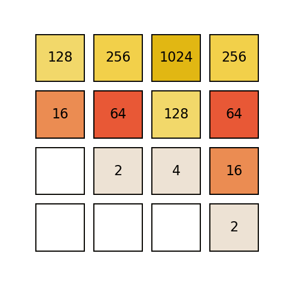

# 2048 Game Using Deep Reinforcement Learning

A value-based RL agent that learns to play **2048** from scratch — no search, no heuristics, no
hand-coded knowledge of the game. Two agents are built and compared, **DQN** and **Dueling DQN**,
both in PyTorch. After 80,000 training episodes both reach the **1024 tile**, and both beat the
deep Q-learning baseline reported by Li & Peng (2021).




> The trained agent playing a game. Every move comes from the learned Q-values.

## Problem setup

2048 is a single-player sliding-tile puzzle on a 4x4 grid. Equal adjacent tiles merge into their
sum, a new tile spawns after every move, and the goal is to build ever-larger powers of two. We
frame it as an MDP and learn a policy end to end.

- **State** — the 4x4 board flattened and one-hot encoded to a length-**288** vector (16 cells x 18
  possible tile values).
- **Actions** — the four swipes (up / down / left / right). Not every action is legal in every
  state, so an action list is maintained per state.
- **Reward** — the sum of `log2` of the merged tile values, minus a penalty for tile movement and a
  penalty for an illegal move.

The reward shaping mattered. The first version simply summed the board values, which turns out to
carry almost no signal: merging two equal tiles leaves the board total unchanged, so the agent got
no feedback for the one action that actually makes progress. Switching to `log2` of the merged
values fixed it.

## Architectures

| | Layers | Composition |
| --- | --- | --- |
| **DQN** | 9 | 4 dense, 3 batch-norm, 3 ReLU. Input 288 → output 4 Q-values. |
| **Dueling DQN** | 13 | 8 dense, 5 batch-norm, 5 ReLU, split into a **value** stream and an **advantage** stream that recombine into Q-values. |

The dueling split is what buys the extra performance: the plain DQN only updates Q for the action
actually taken, while the dueling network learns the state-value from every visit regardless of
which action was tried, so learning is faster in states where the four actions are near-equivalent.

Both agents use **experience replay** (random mini-batches, to break the correlation between
consecutive frames) and a **target network** held fixed for a number of steps to keep the
regression targets from chasing the estimates.

## Training

80,000 episodes with the tuned hyperparameters:

| Hyperparameter | Value |
| --- | --- |
| Learning rate | 0.0005 |
| Batch size | 1024 |
| Replay buffer | 100,000 |
| Epsilon | 0.05, decayed to 0.00001 (decay 0.009), doubled every 5,000 steps to keep exploring |
| Loss | MSE |
| Optimiser | Adam |

**Hyperparameter tuning** was run with [Optuna](https://optuna.org/) over batch size
(64 / 256 / 1024), buffer size (100,000 / 200,000) and learning rate (0.005 / 0.0005), each
combination trained for 250 episodes.

| Slice plot | Parameter importance |
| --- | --- |
|  |  |

## Results

Distribution of the highest tile reached, against the deep Q-learning results of Li & Peng (2021):

| Max tile | Li & Peng, 2021 | DQN | Dueling DQN |
| --- | --- | --- | --- |
| 32 | 0% | 0.77% | 0.54% |
| 64 | 5.7% | 10.14% | 8.31% |
| 128 | 34.2% | 36.19% | 33.8% |
| 256 | 56.1% | 40.74% | 42.29% |
| **512** | 3.9% | 11.88% | **14.61%** |
| **1024** | 0.1% | 0.27% | **0.44%** |

Dueling DQN reaches the two highest tiles noticeably more often than plain DQN — 14.61% vs 11.88%
at 512, and 0.44% vs 0.27% at 1024.

Training curves (red = mean reward over the last 50 episodes, blue = mean steps, green = max tile
seen on the board):


2048 itself was never reached. Longer training on better hardware is the obvious next step — the
curves had not plateaued when training stopped.

## Repository layout

```
Code_Files/
  DQN/Final Run/2048_DQN.ipynb                    # DQN agent, training + evaluation
  DQN/Intermediate Results/                       # loss and episode curves during training
  Dueling-DQN/Final_Run/2048_Dueling_DQN.ipynb    # Dueling DQN agent
  Dueling-DQN/Hyperparameters_Tuning_Results/     # Optuna sweep, per-combination graphs
  Dueling-DQN/Intermediate Results/
Result Pics/                                      # final figures used in the report
Report.pdf                                        # full write-up
PPT.pptx
```

## Running it

The notebooks are self-contained — open either `2048_DQN.ipynb` or `2048_Dueling_DQN.ipynb` and run
top to bottom. A GPU is strongly recommended; 80,000 episodes is not a quick job on CPU.

```bash
pip install torch numpy matplotlib optuna
jupyter notebook "Code_Files/Dueling-DQN/Final_Run/2048_Dueling_DQN.ipynb"
```

## Team

Course project at **Amrita School of Computing, Bengaluru** (Amrita Vishwa Vidyapeetham).

- K. Vishnu Sainadh
- K. Satwik
- V. Ashrith

Full method, decision points and references are in [`Report.pdf`](Report.pdf).

## References

- Li, S. and Peng, V. (2021). *Playing 2048 With Reinforcement Learning.* arXiv:2110.10374
- Mnih, V. et al. (2013). *Playing Atari with Deep Reinforcement Learning.* arXiv:1312.5602
- Van Hasselt, H., Guez, A. and Silver, D. (2016). *Deep Reinforcement Learning with Double
  Q-learning.* AAAI.
- Yeh, K.-H. et al. (2017). *Multistage Temporal Difference Learning for 2048-Like Games.* IEEE
  TCIAIG 9(4).
