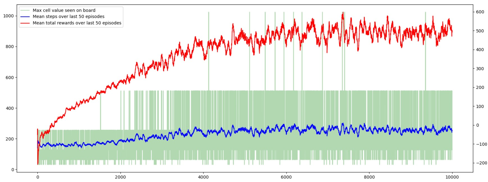
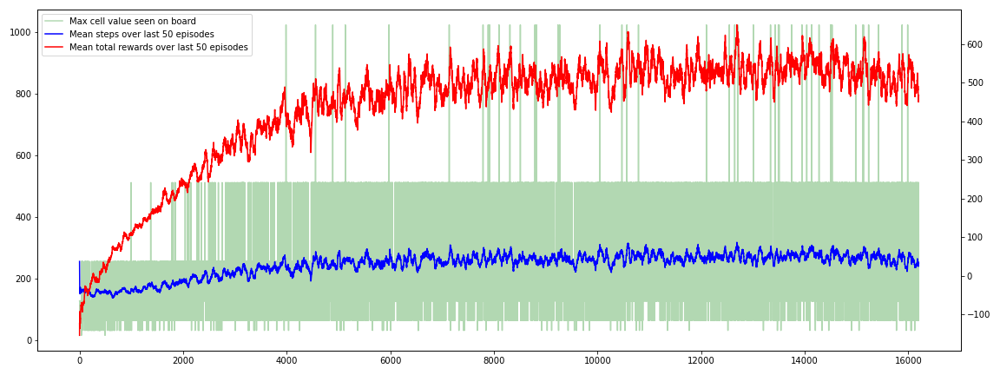
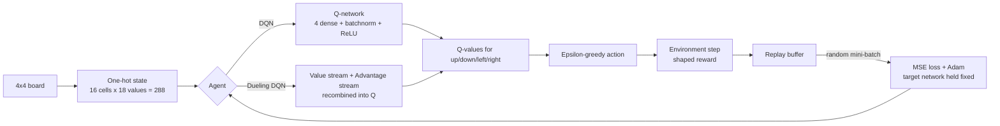
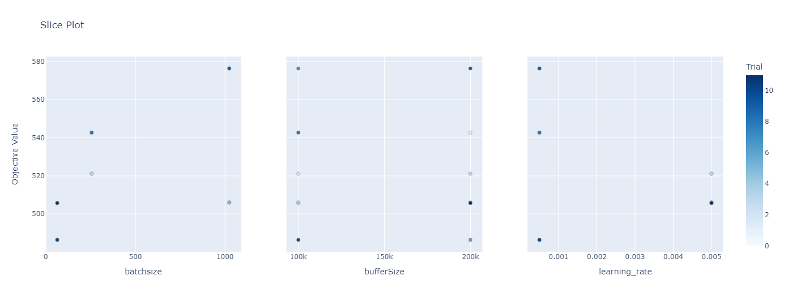
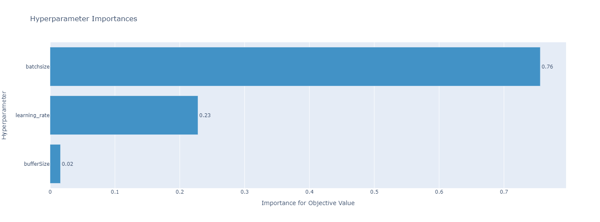

# 🎮 2048 Game Using Deep Reinforcement Learning

A reinforcement learning agent that learns to play **2048** from scratch — no tree search, no
heuristics, no hand-coded knowledge of the game. Two value-based agents, **DQN** and **Dueling
DQN**, are built in PyTorch and compared head to head. After 80,000 episodes both reach the
**1024 tile**, and both beat the deep Q-learning results published by Li & Peng (2021).


> The trained agent playing a game. Every move is chosen from the learned Q-values — there is no
> lookahead of any kind.

## Overview

2048 is a single-player sliding-tile puzzle on a 4x4 grid: equal adjacent tiles merge into their
sum, a new tile spawns after every move, and the aim is to build ever-larger powers of two. Most
strong 2048 players — human or machine — lean on search and on well-known heuristics such as
keeping the largest tile pinned in a corner. This project gives the agent none of that. It sees
only the board, picks one of four swipes, and learns what works from the reward alone.

## Results

Distribution of the highest tile reached over evaluation games, compared against the deep
Q-learning baseline of Li & Peng (2021):

| Max tile | Li & Peng, 2021 | DQN | Dueling DQN |
| --- | --- | --- | --- |
| 32 | 0% | 0.77% | 0.54% |
| 64 | 5.7% | 10.14% | 8.31% |
| 128 | 34.2% | 36.19% | 33.8% |
| 256 | 56.1% | 40.74% | 42.29% |
| **512** | 3.9% | 11.88% | **14.61%** |
| **1024** | 0.1% | 0.27% | **0.44%** |

Both agents beat the baseline at the tiles that are hard to reach. Dueling DQN is the stronger of
the two where it counts — 14.61% vs 11.88% at the 512 tile, and 0.44% vs 0.27% at 1024.

| DQN training | Dueling DQN training |
| --- | --- |
|  |  |

> Red = mean total reward over the last 50 episodes, blue = mean steps per episode, green = the
> highest tile seen on the board. The 1024 tile becomes consistent as training goes on.

The 2048 tile itself was never reached. The curves had not flattened when training stopped, so
more episodes on better hardware is the obvious next step rather than a change of method.

## How It Works



**1. RL formulation.**

- **State** — the board flattened and one-hot encoded to a length-**288** vector (16 cells x 18
  possible tile values).
- **Actions** — the four swipes. Not all are legal in every state, so an action list is maintained
  per state and illegal moves are masked.
- **Reward** — the sum of `log2` of the merged tile values, minus a penalty for tile movement and
  a penalty for an illegal move.

The reward shaping was the decisive design choice. The first version simply summed the board
values, which carries almost no learning signal: merging two equal tiles leaves the board total
unchanged, so the agent received nothing for the one action that actually makes progress. Scoring
`log2` of the merged values fixed it, and had the side effect of teaching the corner strategy
without anyone writing that rule down.

**2. Architectures.**

| | Layers | Composition |
| --- | --- | --- |
| **DQN** | 9 | 4 dense, 3 batch-norm, 3 ReLU. Input 288 → 4 Q-values. |
| **Dueling DQN** | 13 | 8 dense, 5 batch-norm, 5 ReLU, split into a **value** stream and an **advantage** stream recombined into Q-values. |

The dueling split is what buys the extra performance. Plain DQN updates Q only for the action
actually taken, so nothing is learned about the other three. The dueling network learns the
state-value from every visit regardless of which action was tried — which matters in 2048, where
most positions have four near-equivalent moves.

**3. Stability.** Both agents use **experience replay** (random mini-batches, breaking the
correlation between consecutive frames) and a **target network** held fixed for a number of steps
so the regression targets stop chasing the estimates.

**4. Hyperparameter tuning.** Run with [Optuna](https://optuna.org/) over batch size
(64 / 256 / 1024), buffer size (100,000 / 200,000) and learning rate (0.005 / 0.0005), each
combination trained for 250 episodes.

| Slice plot | Parameter importance |
| --- | --- |
|  |  |

Final settings: learning rate **0.0005**, batch size **1024**, buffer **100,000**, epsilon from
0.05 decayed to 0.00001 (decay factor 0.009, doubled every 5,000 steps to keep exploring), MSE
loss, Adam optimiser, 80,000 episodes.

## Tech Stack

- **Language**: Python
- **Deep Learning**: PyTorch
- **Hyperparameter Optimisation**: Optuna
- **Numerical / Plotting**: NumPy, Matplotlib
- **Environment**: Jupyter Notebook

## Repository Structure

```
2048-Game-Using-Deep-Reinforcement-Learning/
├── src/
│   ├── DQN/
│   │   ├── Final Run/2048_DQN.ipynb              # DQN agent: training + evaluation
│   │   └── Intermediate Results/                 # loss and episode curves during training
│   └── Dueling-DQN/
│       ├── Final_Run/2048_Dueling_DQN.ipynb      # Dueling DQN agent
│       ├── Hyperparameters_Tuning_Results/       # Optuna sweep, per-combination graphs
│       └── Intermediate Results/
├── docs/
│   ├── Report.pdf                                # full project report
│   ├── PPT.pptx                                  # project presentation
│   └── result-figures/                           # figures used in the report
├── assets/                                       # figures used in this README
├── README.md
└── LICENSE
```

## Running the Project

The notebooks are self-contained. Open either agent and run it top to bottom — a GPU is strongly
recommended, since 80,000 episodes is not a quick job on CPU.

```bash
pip install torch numpy matplotlib optuna
jupyter notebook "src/Dueling-DQN/Final_Run/2048_Dueling_DQN.ipynb"
```

## Dataset

None. This is a reinforcement learning project — the agent generates all of its own training data
by playing the game, so there is nothing to download.

## Future Scope

- Train for more episodes on stronger hardware to push past 1024 toward 2048 and beyond.
- Try distributional or double Q-learning variants on the same environment.
- Compare the learned policy against expectimax search to see how much of the gap is search.

## Acknowledgments

Course project at **Amrita School of Computing, Bengaluru** (Amrita Vishwa Vidyapeetham), by
Vishnu Sainadh Kedarisetty, Satwik Kukkadapu and Ashrith Vadde.

## References

- Li, S. and Peng, V. (2021). *Playing 2048 With Reinforcement Learning.* arXiv:2110.10374
- Mnih, V. et al. (2013). *Playing Atari with Deep Reinforcement Learning.* arXiv:1312.5602
- Van Hasselt, H., Guez, A. and Silver, D. (2016). *Deep Reinforcement Learning with Double
  Q-learning.* AAAI.
- Yeh, K.-H. et al. (2017). *Multistage Temporal Difference Learning for 2048-Like Games.* IEEE
  TCIAIG 9(4), 369–380.

## Documentation

- 📄 [Project Report](docs/Report.pdf)
- 📊 [Presentation](docs/PPT.pptx)
